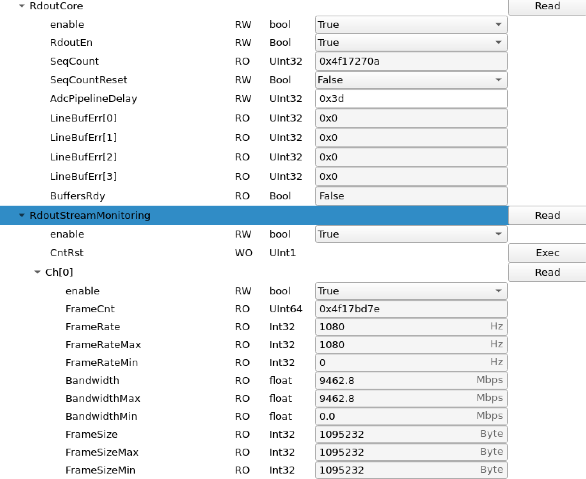

> Historical ASC test note. Paths and releases below reflect the 2025 test; check current deployment before use.

# epix10ka Integration for UED DAQ

This project documents the integration process of a 1kHz epix10ka detector into the UED DAQ system. The detector is currently hosted on `daq-det-evr01` with development GUIs and configuration tools available under the `lcls2-epix-hr-pcie` software tree.

---

## 📍 Detector Setup (Updated)

- **Host node:** `daq-det-evr01`
- **PCIe Device Path:** `/dev/datadev_0`
- **KCU Type:** `XilinxKcu1500`

### ✅ Latest Working Status

Successfully integrated and ran **epix10ka at 1 kHz** with the DAQ on `det-daq`.

**Important Notes:**
- You may need to **reboot** the epix10ka in the Detector Clean Room at the ASC Lab.
- **DO NOT** load Julian’s configuration YAML — doing so will reduce FrameSize to 1600 bytes. See [1600-byte image troubleshooting](../troubleshooting/12_troubleshoot_1600_byte_frame.md).
- After reboot, start with the base config and only apply changes below.

### DAQ Startup Instructions:

```bash
ssh det-daq -l detopr
cd scripts
source setup_env.sh   # (should be version lcls2_071425)
procmgr start epix10ka.cnf
```

```bash
ssh det-daq-evr01
./lcls2/launch_drp_test.sh   # launches drp with correct ulimit (requires sudo)
```

### Configuration Changes:

In `psdaq/configdb/epixquad_config.py`, update:
```python
event_rate_hz = 1020
devPtr.EventBuilder.Timeout.set(int(156.25e6 / event_rate_hz))
```

In your config for `epix10ka_0`:
```yaml
user.start_ns: 150000           # Smaller values (e.g., 110000) may cause TEB Fixup errors
expert.EpixQuad.AcqCore.AsicRoClkHalfT: 1
```
> ℹ️ Value `1` will be OR’ed in `epixquad_config.py`. Setting `3` here results in only ~340 Hz rate.

---

## 🚀 Dev GUIs

### KCU Board GUI

To launch the board-level dev GUI:

```bash
python scripts/devGui.py --dev /dev/datadev_0 --pgp4 1 --serverPort 9004 --pcieBoardType XilinxKcu1500
```

**Location:**
`/cds/home/j/jumdz/lcls2-epix-hr-pcie/software`

---

### Camera GUI

To launch the epix10ka QuadDAQ GUI:

```bash
python scripts/epixQuadDAQ.py --l 0 --dev /dev/datadev_0
```
optional `--viewer 1` will bring ImageViwer for this epix (bur currently not showing anything - possibly broken).

**Location:**
`/cds/home/j/jumdz/epix-quad/software`

or in **Spy mode**
```bash
python -m pyrogue gui --server='localhost:9103'
```

Check `RdoutStreamMonitoring.Ch[0].FrameCnt`, `FrameRate`, and `FrameSize` to confirm that frames arrive and contain a full image (about 1 MiB).



---

## 🛠 Status

| Component     | Host           | Status     |
|---------------|----------------|------------|
| epix10ka      | daq-det-evr01  | ✅ Working at 1 kHz |
| devGui        | Installed      | ✅          |
| QuadDAQ GUI   | Installed      | ✅          |
| DAQ Pipeline  | Integrated     | ✅          |

---

## 📝 Notes

*Removed – content deprecated*

---

## 📎 To Do

*Removed – all tasks completed and verified*
